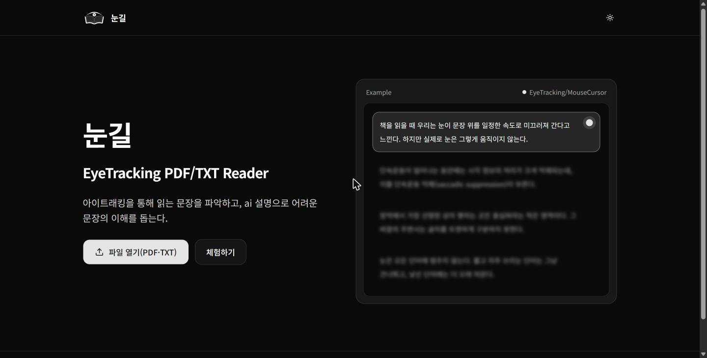
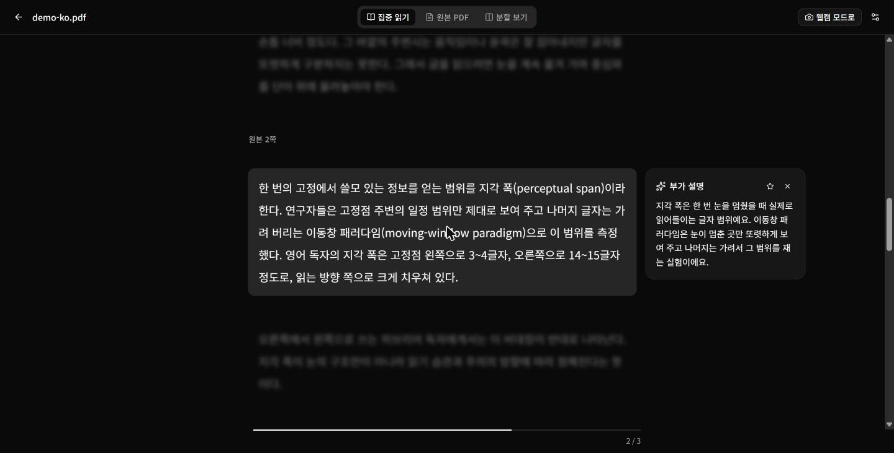
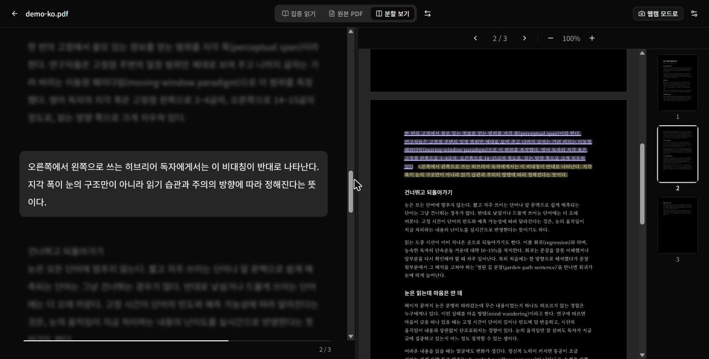

# 눈길

웹캠 아이트래킹으로 읽는 부분을 따라가며, 어려운 문단을 AI로 설명해 주는 PDF·TXT 리더입니다.
INTHON 2026 16팀 **AttentionIsAllYouNeed**가 '감각(시각 정보)'을 주제로 만들었습니다.

**[데모 바로가기](https://eye-tracking-pdf-reader.vercel.app/)** · **[시연 영상](https://youtu.be/W_W9xPVCj_k)** · 첫 화면의 **체험하기**를 누르면 샘플 PDF로 시작합니다.



긴 글을 읽다 보면 어디까지 읽었는지 놓치고, 모르는 내용이 나오면 흐름이 끊깁니다. 눈길은 PDF를 읽기 좋은 문단 단위로 다시 배치하고, 읽는 문단만 선명하게 보여 주고, 한 문단에 오래 머물거나 미간을 찡그리면 그 자리에서 설명을 띄웁니다.

## 화면

**집중 읽기:** 읽는 문단만 선명하게 보여 주고, 오래 머문 문단에는 AI 설명을 띄웁니다.



**분할 보기:** 원본 PDF가 읽는 위치를 따라갑니다. 노란색은 지금 읽는 곳, 보라색은 즐겨찾기한 설명이 있는 곳입니다.



## 주요 기능

- **문단 재배치:** PDF의 글자를 문맥 단위 블록으로 나누고, 줄 간격을 넓혀 다시 보여 줍니다. TXT도 열 수 있습니다.
- **가운데 고정 읽기:** 읽는 블록을 화면 가운데에 두고 나머지는 흐리게 합니다. 칸 아래쪽을 보면 다음 블록, 위쪽을 보면 이전 블록으로 넘어가고, 넘어가기까지 남은 시간을 막대로 보여 줍니다.
- **부가 설명:** 예상 읽기 시간보다 오래 머물거나 찡그리면 AI 설명을 띄웁니다.
- **즐겨찾기:** 설명을 별로 저장하면 원본 PDF에 표시가 남고, 표시를 누르면 저장한 설명을 다시 볼 수 있습니다.
- **분할 보기:** 재배치한 글과 원본 PDF를 나란히 보여 주고, PDF의 하이라이트가 읽는 위치를 따라갑니다.
- **개인 보정과 자세 안내:** 카메라 화면에서 시작 자세를 맞춘 뒤 12개 점으로 보정합니다. 읽는 동안 자세가 달라지면 알려 주고, 언제든 다시 보정할 수 있습니다.
- **마우스 모드:** 웹캠을 쓸 수 없으면 커서 위치를 시선 대신 사용합니다.

## 시작하기

Node.js 20.9 이상과 웹캠이 있는 환경이 필요합니다. Chrome에서 개발하고 시험했습니다.

```bash
npm install
cp .env.example .env.local
npm run dev
```

브라우저에서 <http://localhost:3000>을 열고 **체험하기**를 누르면 샘플 PDF로 바로 시작합니다. 직접 쓰는 PDF나 TXT를 올려도 됩니다.

### 환경 변수

`.env.local`에 설정합니다. 모두 없어도 실행되며, `LLM_API_KEY`가 없으면 부가 설명은 목업 문구로 나옵니다.

| 이름 | 설명 | 기본값 |
| --- | --- | --- |
| `LLM_API_KEY` | OpenAI 호환 LLM API 키 | 없음 |
| `LLM_BASE_URL` | LLM API 주소 | Lablup Token Factory |
| `LLM_MODEL` | 모델 이름 | `DeepSeek-V4.1-Flash-B300` |

### 명령어

| 명령어 | 하는 일 |
| --- | --- |
| `npm run dev` | 개발 서버 실행 |
| `npm run build` | 프로덕션 빌드 |
| `npm run start` | 빌드한 앱 실행 |
| `npm run lint` | ESLint 검사 |

## 동작 방식

1. **블록 변환:** 브라우저에서 pdf.js로 글자를 뽑아 문맥 단위 블록으로 나눕니다.
2. **시선 추정:** MediaPipe Face Landmarker가 얼굴과 홍채 위치를 찾고, 12점 보정으로 학습한 개인 모델이 화면 좌표를 추정합니다.
3. **읽기 판단:** 웹캠 좌표는 오차가 커서 시선으로 블록을 직접 고르지 않고, 칸의 위·가운데·아래 중 어디를 보는지로 넘깁니다.
4. **설명 요청:** 설명이 필요할 때 서버의 `/api/explain`이 LLM을 호출합니다. API 키는 서버에만 둡니다.

### 데이터 처리

- 카메라 영상과 업로드한 파일은 브라우저 안에서만 처리하고 서버로 보내지 않습니다.
- 부가 설명을 요청할 때는 해당 문단과 앞뒤 문단의 글자만 LLM으로 보냅니다.
- 로그인 기능과 서버의 문서 저장 기능은 없습니다.
- 마지막으로 연 파일 하나는 이 브라우저의 IndexedDB에 남습니다. 새로고침하거나 나중에 `/reader`를 다시 열어도 그 파일이 열리고, 다른 파일을 열면 덮어씁니다.
- **여러 사람이 쓰는 컴퓨터에서는 다음 사람이 앞사람의 파일을 볼 수 있습니다.** 사용을 마치면 브라우저 설정에서 이 사이트의 데이터를 삭제하거나 시크릿 창을 사용해 주세요.
- 시선 보정 결과와 즐겨찾기는 메모리에만 있어 새로고침하면 사라집니다.

## 기술 스택

- **프레임워크:** Next.js 16 (App Router), React 19, TypeScript
- **UI:** Tailwind CSS 4, shadcn/ui
- **PDF:** pdf.js (`pdfjs-dist`)
- **시선 추적:** MediaPipe Face Landmarker
- **LLM:** OpenAI 호환 API (기본 Lablup Token Factory)
- **배포:** Vercel

## 폴더 구조

```text
app/
  page.tsx              랜딩과 업로드
  reader/               리더 화면
  api/explain/          부가 설명 API
  lab/gaze/             시선 엔진 시험, 데이터 수집과 비교 페이지
components/
  reader/               리더 컴포넌트
  gaze/                 보정 화면, 얼굴 위치 가이드
  landing/              랜딩 컴포넌트
lib/
  gaze/                 시선 추정, 스무딩, 찡그림 감지, 설정값
  pdf/                  텍스트 추출과 블록 변환
  llm/                  프롬프트
public/samples/         데모용 PDF
docs/                   API 명세, 기술 결정 기록
```

## 알려진 한계

- 모바일은 지원하지 않습니다.

## 팀

**AttentionIsAllYouNeed** (INTHON 2026 16팀)

| 이름 | 맡은 일 |
| --- | --- |
| 민서 | 팀장(PM), 시선 엔진 학습, UX |
| 김정인 | 리더 화면, 업로드 UI |
| 박정훈 | PDF 변환, LLM API |
| 김준영 | 랜딩, 데모 PDF, 프롬프트 |

## 더 보기

- [API 명세](docs/api.md)
- [기술 결정 기록](docs/decisions.md)
- [팀 작업 규칙](AGENTS.md)
